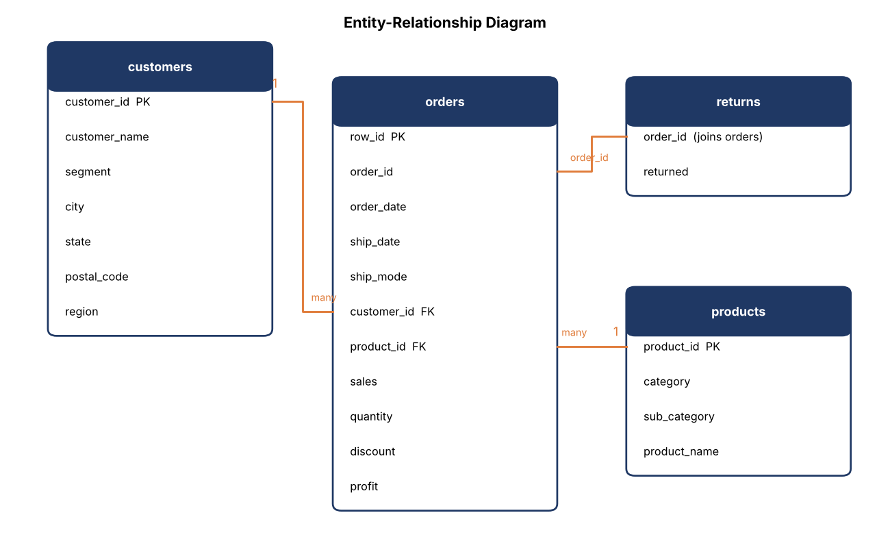
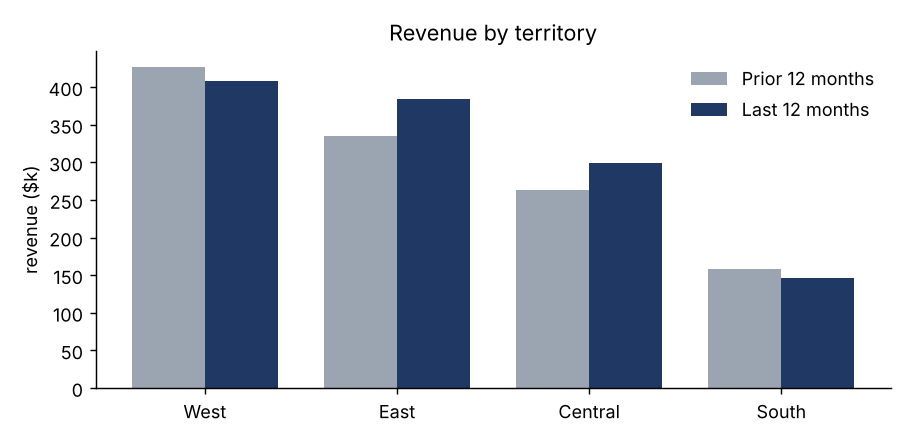
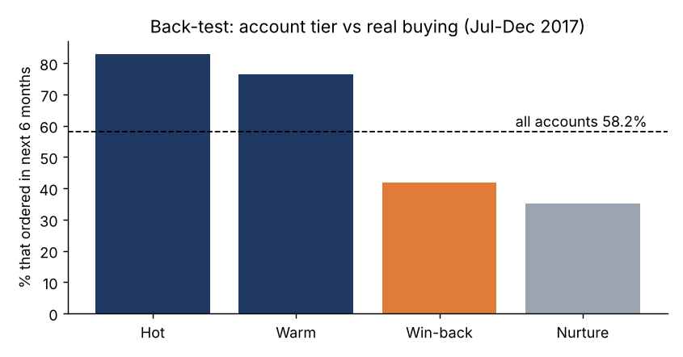

# Amazon Sales Analysis with SQL

Welcome to this Amazon sales analytics project. The work explores transactional data to surface trends that inform sales strategy, reveal customer behaviour, and improve day-to-day business operations. On top of the ten business questions, it turns the data into a **sales playbook**: territory scorecards, account qualification, needs-based talking points, and a multi-channel outreach cadence with a live Excel tracker.


## Introduction
The analysis uses a dataset of Amazon-style sales records containing order dates, customer details, product hierarchies and financial metrics. Using SQL (SQLite) and Python, the project answers key business questions and extracts practical insights. It then asks the question a sales team cares about most: **which accounts should we contact first, through which channel, and what should we say?**

## Dataset Overview
The dataset contains **9,994 rows**, each one an order line, across **5,251 orders, 793 customers, 1,640 products, 17 sub-categories, 3 categories and 49 states** (Jan 2014 to Dec 2017), plus a returns file covering 401 returned orders.

The data is **simulated** by `src/generate_data.py` to mirror the structure of the public Kaggle Amazon/Superstore sales data, so every number here can be reproduced and checked. Before analysis it was cleaned; the problems planted in the raw file were all found:

| Check | Rows fixed |
|---|---|
| Exact duplicate rows removed | 30 |
| Ship date before order date (swapped back) | 12 |
| Negative sales (sign corrected) | 6 |
| Profit larger than sales (x100 unit error corrected) | 4 |
| Missing customer name (filled from the same customer) | 8 |
| Missing postal code (filled from the same customer) | 15 |

Full log: `results/data_quality_report.txt`.

## Questions Answered
All queries are in `sql/analysis.sql`; every result is saved in `results/business_questions/`.

1. **Top five customers by total profit:** John Hughes (Corporate, Washington) leads with $12,805 profit on $39,579 sales.
2. **Average quantity per category:** almost flat, Office Supplies 3.68, Technology 3.62, Furniture 3.60 units per line.
3. **Top five products by revenue:** led by Samsung Copier M866 ($161,038); three of the five are Copiers or Machines.
4. **Five products whose revenue fell most vs the previous year (2017 vs 2016):** Hon Machine O478 fell 92.6% ($34,045 to $2,505).
5. **Most profitable sub-category:** Copiers, $173,824 profit at a 37.1% margin. Tables, Bookcases and Machines lose money.
6. **States with the most orders:** California (1,057), New York (597), Texas (552).
7. **Month with the most orders:** December (754), then November and September.
8. **Profit margin per sale:** lines with no discount make a 16.9% margin; at 21-40% off the margin is -35.7%, and 95.8% of those lines lose money.
9. **Sub-category share of sales:** Phones 15.2%, Machines 13.9%, Chairs 13.6%.
10. **Top two categories by returns:** Office Supplies (290 returned orders, 7.69%) and Furniture (140, 7.97%).

## Entity-Relationship Diagram (ERD)


`customers` (1) to `orders` (many) on `customer_id`; `products` (1) to `orders` (many) on `product_id`; `returns` joins `orders` on `order_id`. Schema: `sql/schema.sql`.

## Sales Playbook
Built in `sql/sales_playbook.sql` and `src/playbook.py`. It covers the day-to-day work of an outbound sales role.

### 1. Territory scorecard
Revenue, margin, active accounts, average order value, discounting and returns for each territory (West, East, Central, South), plus the change in revenue over the last 12 months. East grew fastest (+14.9%) and South shrank (-7.7%). A **whitespace** query flags states whose revenue per account is far below their territory's average (Alabama 35%, Delaware 43%, Iowa 43%), so those are where to prospect.



### 2. Account qualification, back-tested
Every account is scored on recency, frequency and spend (SQL `NTILE` quintiles) and placed in a tier: **Hot, Warm, Win-back or Nurture**. To check the scoring works, accounts were scored using only data up to 30 Jun 2017, then compared with what they actually bought in Jul-Dec 2017:

| Tier | Accounts | Ordered in next 6 months | Share of next 6 months' revenue |
|---|---|---|---|
| Hot | 215 | 82.8% | 47.6% |
| Warm | 170 | 76.5% | 24.3% |
| Win-back | 74 | 41.9% | 8.8% |
| Nurture | 313 | 35.1% | 19.3% |
| All accounts | 772 | 58.2% | 100% |

Hot and Warm accounts are half the list but brought **71.9%** of the next six months' revenue. A test checks the scoring never uses orders after the cutoff.



### 3. Needs identification and talking points
For each account: the three sub-categories it buys most (its current needs), and two it does not buy yet that similar accounts in its segment do. In the same back-test, these suggestions matched what the account went on to buy **25.4%** of the time, against **16.3%** for two random picks (**1.56x**).

### 4. Multi-channel outreach cadence
Each tier gets a fixed sequence of calls, emails, LinkedIn messages and a Zoom demo invite. Hot accounts, for example, get a discovery call and a recap email on day 1, LinkedIn on day 3, a follow-up call on day 5 and a demo invite on day 7. Win-back accounts open with "what changed?" instead of a pitch. The plan has **2,164 dated touches** across 482 accounts (`results/sales_playbook/outreach_cadence.csv`), each with talking points.

Calls only go out between 10 AM and 5 PM in the customer's time zone. Converted to IST, East and South accounts can be called from 20:30 to 03:30 IST, so the 6 PM-4 AM IST shift covers the whole window. West accounts can be called for only 4.5 hours of either US shift, so email and LinkedIn carry more of the load there.

### 5. Excel outreach tracker
`results/outreach_tracker.xlsx` lists all 793 accounts with tier, needs, suggestions, call window and shift. A rep fills in the yellow columns (steps done, last touch date, status from a dropdown). **Live formulas** then work out the next step, channel and due date from the cadence sheet, and a summary sheet counts accounts by territory and tier, demos booked and touches due.

### 6. Weekly sales brief
`reports/sales_brief.md` is generated from the results: territory movement, who to call first, what to pitch, calling windows and feedback for the team (for example, avoid leading with deep discounts, since lines more than 20% off lose money on average).

## How to run
```bash
pip install -r requirements.txt
cd src && python run_all.py     # data, cleaning, SQL, playbook, tracker, charts, brief
cd .. && python -m pytest -q    # 9 tests
```
GitHub Actions runs the full pipeline and the tests on every push.

## Project structure
```
data/raw/            raw export and returns (as generated, with planted problems)
data/clean/          normalised tables (customers, products, orders, returns)
sql/                 schema.sql, analysis.sql (10 questions), sales_playbook.sql
src/                 generate_data, clean, run_analysis, playbook, tracker, charts, brief, run_all
results/             data quality report, question results, playbook outputs, outreach_tracker.xlsx
charts/              8 charts and the ERD
reports/             sales_brief.md
tests/               pytest suite
```

## Limitations
- **The data is simulated.** Patterns such as discount losses, seasonality and customers who stop buying were built into the generator, so the results show the method rather than real Amazon performance.
- The cadence and calling windows are a plan, not a measured campaign. Time zones use US standard time and ignore daylight saving.
- The suggestions only beat random picks by 1.56x, because customers' category choices in the simulation are fairly random. Real data with stronger buying patterns would be needed to judge them properly.

## Conclusion
This project delivers insights into Amazon sales dynamics, customer patterns and operational drivers, then turns them into a sales plan: which territories to focus on, which accounts to contact first, what to say, and when to call. By answering targeted questions with SQL and checking the results against what happened next, it supports data-driven decision-making and sales optimisation. Contributions and enhancements are welcome.
